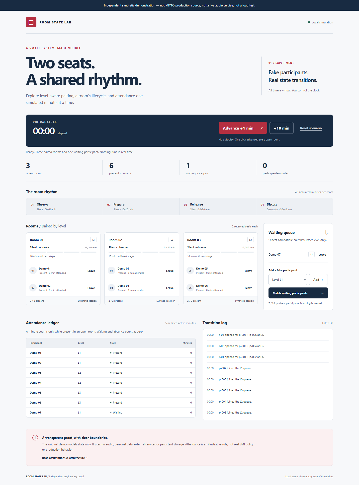

# MIYTO Smart Rooms — Product Case Study

MIYTO is an audio-first, level-aware learning-room experience developed for Superior Multiskills Institute (SMI). It structures learner practice into paired rooms, guided silent-practice rounds, and moderated speaking discussions.

> Public MIYTO documentation and an independent synthetic demo only. No MIYTO application source, student records, production credentials, internal endpoints, or production deployment configuration are included.

## Independent runnable engineering demo

**Independent synthetic demonstration — not MIYTO production source, not a live audio service, not a load test.**

[Explore Room State Lab](demo/room-state-lab/README.md): an original local web demo with fake participants, level-aware two-person rooms, a virtual clock and simulated attendance. No MIYTO application source, real records, original assets or production integrations are used. [Engineering notes](docs/DEMO-ENGINEERING-NOTES.md) explain the boundaries; the historical MIYTO validation figures below are separate evidence and do not apply to this demo.

[Independent browser QA report](demo/room-state-lab/BROWSER_QA_REPORT.md) · [Mobile screenshot](demo/room-state-lab/assets/mobile-preview.png) · [GitHub Actions PASS on published main commit](https://github.com/a7medgamil/miyto-smart-rooms-showcase/actions/runs/44894982610).

**Engineering proof (21 November 2026):** 26/26 automated tests passed with independent local rerun, deterministic browser interaction checks at desktop and mobile viewport sizes, and successful main-branch CI. These are tests of an original synthetic sample, not the live MIYTO application. [Read setup and limitations](demo/room-state-lab/README.md).

## Product scope

- Paired learner rooms with level-aware matching and room lifecycle management.
- Structured practice rounds followed by guided speaking discussions.
- A curated discussion bank documented as 240 topics and 4,800 question slots.
- Attendance synchronization and session-window workflows.
- Peer reporting, moderation restrictions, and auditable handling.
- Administrative room visibility and session oversight.

## Engineering validation snapshot

The pre-merge QA snapshot was checked on 13 November 2026 on branch `codex/qa-miyto-20261113` (base commit `018a5aa`). Results below are tied to that tested snapshot, not automatically to later `main` revisions:

| Check | Result |
|---|---:|
| Unit assertions | 1,202 passed; 61 skipped |
| Worker / Durable Object assertions | 180 passed; 2 skipped |
| Build | Passed |
| Type generation and typecheck | Passed |
| Browser credential scan | Passed |
| GitHub Actions validation workflow | Passed on the tested snapshot; a later main-branch result is recorded below |

**Combined assertions:** 1,382 passed, 63 skipped, 0 failed.

These results describe the tested pre-merge engineering snapshot only. The GitHub Actions run on that snapshot passed on commit `fea2731` (run `43429281744`); an earlier successful run also completed on `217f68c` (run `43332200388`). These results are not a production certification or a live-media end-to-end result.

## Attendance alarm CI issue — resolved (15 November 2026)

The initial main-branch merge commit `0bea82f` (PR #1) triggered CI run `43429940694` and failed `tests/workerd/attendance-sync-alarm-20261106.test.ts`: the test expected `recorded` but observed `pending`.

**Root cause:** the test used fixed November 8–11, 2026 timestamps. When CI ran on November 13, those simulated instants were already in the past relative to Workerd's real clock. Workerd could auto-fire the Durable Object alarm before the test explicitly invoked its alarm helper, making the assertion timing-dependent. This was a test-fixture race, not evidence of a production attendance failure.

**Fix merged in the private application repository:** PR #2, commit `d2343d2`. Private source and review history are not accessible to an unsigned-in recruiter; the public postmortem below provides the independently readable explanation.

- Replaced hard-coded dates with future Riyadh-local test instants.
- Restored an explicit assertion that the Durable Object alarm helper delivers the hand-off.
- Removed the fallback that directly called `alarm()` when the test remained pending.
- Left attendance application code, production configuration and live data unchanged.

**Post-merge verification:** the private application's GitHub Actions run `43633701186` passed on main commit `d2343d2` (maintainer-only evidence, not a publicly inspectable check). The independent public Room State Lab and its linked CI above remain separately accessible.

[Read the public postmortem](docs/ATTENDANCE-ALARM-TEST-RACE.md) for the failure sequence, root cause, deterministic fixture fix and limits of the verification.

- Cloudflare type generation and TypeScript typecheck: passed.
- Unit tests: 1,263 total; the local full-suite run recorded 1,202 passed and 61 skipped.
- Worker / Durable Object tests: 31 files, 180 passed, 2 skipped.
- Production build and browser credential scan: passed.

The fix makes the CI alarm test deterministic. It does not constitute a production deployment, a live attendance bridge test, a live SFU test, or a 400-participant capacity certification.

## Explicit limitations

- The isolated 400-participant / 200-room load scenario was not run.
- A live SFU end-to-end test was not run in this QA pass.
- Production deployment and live configuration changes were outside the validation scope.
- Bundle-size optimization remains follow-up engineering work.

## Product access

[MIYTO student experience](https://secondary-session.smi-platform.org/) · [Portfolio case study](https://ahmed-gamil-portfolio.ahmedabdulbarim.workers.dev/case-studies/miyto-smart-rooms)

## Publication boundary

The application source remains in a separate private repository. No client or learner data is published.

© 2026 Superior Multiskills Institute. All rights reserved.
