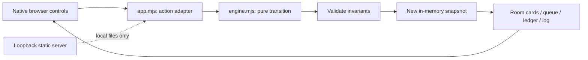

# Room State Lab

> **Independent synthetic demonstration — not MIYTO production source, not a live audio service, not a load test.**

An original, dependency-free engineering proof. Explore small paired rooms, exact-level matching, virtual time and a minute-by-minute attendance ledger using only generated labels such as `Demo 01`. The public case-study documents supplied context; no production implementation, modules, endpoints, records or assets are used here.

## Quick start

Requires Node.js 22 or newer and its bundled npm. No install step, account or environment variables.

```sh
cd demo/room-state-lab
npm test
npm run check
npm start
```

Open **http://127.0.0.1:4173**. Stop with Ctrl+C. The static server binds only to `127.0.0.1`, never all interfaces. If that port is occupied, stop the conflicting local process before retrying. The app makes no external requests; the browser loads only this demo’s local static assets. There is no application backend or API.

## Try the proof

1. Start with three rooms (L1, L2, L3) and one L1 participant waiting.
2. Advance **+10 min** to cross the first silent-stage boundary.
3. Choose **Leave** for Demo 01; advance **+1 min**. Its partner gains a minute while Demo 01 does not.
4. Choose **Rejoin** and advance again. The returning participant gains only new active minutes.
5. Add another L1 participant, then choose **Match waiting participants**. The new room starts at minute zero while existing rooms retain their own elapsed time.
6. Advance through minute 40. Completed rooms retain their ledger and close rejoining. **Reset scenario** restores the original state.

## Feature map

| Area | Visible proof | Implementation |
| --- | --- | --- |
| Queue | Fake people, level selector, explicit matching | Stable oldest-compatible-pair scan |
| Rooms | Two reserved seats, presence and stage progress | Exact-level membership invariants |
| Clock | +1 / +10 minutes, no autoplay | Integer virtual clock, no wall time |
| Attendance | Per-person minutes and aggregate participant-minutes | Active presence per simulated interval |
| Lifecycle | Leave, rejoin, completion, reset | Validated pure transitions |
| Evidence | Timestamped transition log, tests and QA report | Latest 30 events in memory |
| Access | Native controls, labels, skip link, live status, focus restoration | Responsive CSS and reduced-motion rule |

## Exact simulation assumptions

These are **invented demo rules**, not real SMI attendance policy or verified production behavior.

- Levels L1, L2 and L3 are arbitrary synthetic buckets, not learner assessments. Matching requires equality; no cross-level fallback, scoring or fairness beyond queue order.
- Adding queues a person; matching is a separate action. The matcher scans the queue from the front and picks the first person with a later same-level partner. Remaining order is stable. Rejoining a queue appends to its end.
- A room opens with exactly two unique participants. Seats and level never change. Each person can belong to at most one room for the entire scenario. No room transfers or repeat sessions.
- Each room has its own elapsed clock: observe `[0,10)`, prepare `[10,20)`, rehearse `[20,30)`, discussion `[30,40)`, then complete at 40. The discussion duration of 10 minutes is an original demo assumption. “Silentâ€‌ and “discussionâ€‌ are state labels; there is no media behavior or content service.
- A tick of N minutes applies N whole intervals, `[t,t+1)`. Each participant with status `in-room` in an incomplete room earns exactly one minute per interval, including when their partner is absent. Waiting, away and completed people earn zero. No rounding, attendance threshold, real timestamps or synchronization.
- Leaving takes effect immediately, before the next tick. A room keeps running when one or both people leave. Rejoining an incomplete room resumes at its current stage with no backfill or restart. Completion changes present people to `finished`; absent people remain `left` with a closed seat. Neither can rejoin or leave after completion.
- The global clock can advance after all rooms complete. Room time caps at 40; attendance never exceeds that person’s room elapsed time. New rooms start at zero regardless of global time.
- The scenario has a deliberate ceiling of 24 fake people and at most 12 rooms; it is for inspection, not capacity measurement. Individual tick actions accept 1–120 integer minutes. The UI offers 1 and 10.
- All state is in memory. Reload/reset clears it. A reset creates the same seven people, three pairs and one waiting participant. There are no cookies, browser storage, real names, free-text identity fields, microphone, webcam, telemetry, external assets, packages or remote calls.

## Architecture



`engine.mjs` has no DOM, I/O, randomness or real clock. It clones the input, validates the action, applies a transition, checks invariants and returns a new snapshot. Invalid actions throw and leave the input unchanged. `app.mjs` renders text through DOM APIs and restores keyboard focus when participant controls are replaced. `server.mjs` exposes six allowlisted routes with restrictive content, media, connection and permission headers. Inline styles are allowed for computed progress widths; inline scripts are not.

## Testing and checks

`npm test` uses `node:test` and `node:assert/strict`. It covers deterministic fixtures, frozen input, IDs and membership, exact-level queue order, explicit matching, all stage boundaries, fake-clock batching, attendance while absent, queue rejoin, closed rooms, concurrent room clocks, invalid transitions, participant limits and bounded logs. Local HTTP integration tests check allowlisted assets, security headers, rejected paths, methods and HEAD responses. All HTTP test traffic is loopback only, using an ephemeral port.

`npm run check` syntax-checks each `.mjs`, rejects package dependencies, checks a few accessibility hooks, and guards browser sources against selected remote, media and storage APIs. This is a narrow static check, **not** a complete accessibility, privacy or security audit. See [QA_REPORT.md](QA_REPORT.md) for actual commands, exit codes, scan scope and untested areas.

The GitHub workflow runs only these built-in checks on Node 22 with read-only repository permission, no install step, secrets or deployment. A workflow file is not evidence of a completed remote CI run.

[Independent Playwright/Chrome browser QA report](BROWSER_QA_REPORT.md) with actual desktop/mobile interaction results and [desktop](assets/desktop-preview.png) / [mobile](assets/mobile-preview.png) full-page screenshots. This is automated testing, not a claim of full accessibility certification.

## Screenshots and manual review

Run the server, open the loopback URL, and reset before each sequence. Use browser screenshots at desktop (for example 1440 أ— 1000) and mobile (390 أ— 844); keep the independent-demo disclaimer visible in any shared crop. Recommended frames: initial state, Demo 01 away after 11 minutes, discussion at 30 minutes, and a completed ledger at 40. Use a full-page screenshot for the lower ledger/log. Browser/device tooling is optional and is not bundled.

For keyboard review, Tab from the skip link through clock controls, participant actions, level selector, Add and Match. Activate with Enter/Space; check visible focus after Leave/Rejoin and queue removal. Test a narrow viewport and 200% zoom for overflow. Use the OS reduced-motion setting if needed. Native screen-reader behavior, touch devices and multiple browser engines require separate manual verification; static hooks do not establish conformance.

## Limitations

No authentication, authorization, real attendance, backend persistence, server coordination, moderation, scheduling, discussion bank, notifications, audio transport, live users, deployment or load generation. One browser tab is an isolated simulation; tabs do not coordinate. The event log is a bounded inspection aid, not a durable audit record. Snapshot input is an internal API and is not a secure untrusted-data ingestion format. The demo makes no claims about MIYTO production quality, capacity, SMI policy, WCAG certification or real media performance.
