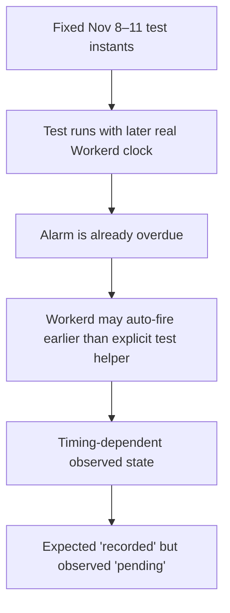

# Engineering Case Study — A Time-Dependent Attendance Test Race

**Scope:** verified CI/test incident, **not** a verified production attendance incident  
**Engineering snapshot:** November 2026 · **Public-safe retrospective prepared:** 21 November 2026

> This case describes a recorded CI failure and a subsequent merged *test-fixture correction* in the private MIYTO engineering repository. Its source links require authorized repository access. No student records, private code or deployment configuration are reproduced here. It does not prove that production attendance had or did not have unrelated defects.

## 1. Context and operational risk

MIYTO's engineering architecture uses Cloudflare Workers and Durable Objects for server-owned room state and session coordination. An integration test exercised the handoff by a Durable Object alarm to an attendance-recording path.

The test contained **fixed timestamps from 8–11 November 2026**, chosen when the fixture was originally written. That was an unstable assumption when tests were executed later against a runtime clock that kept advancing.

The professional concern was not only a red build. A non-deterministic test makes releases harder to verify: developers may misclassify an infrastructure/runtime timing race as an application defect, and a green result can depend on when the test happens to run.

## 2. Recorded failure

| Evidence item | Dated record |
|---|---|
| CI run | [Workflow run 43429940694](https://github.com/a7medgamil/miyto-smart-rooms/actions/runs/43429940694) (private) |
| Main merge | `0bea82f` (recorded as PR #1) |
| File under test | `tests/workerd/attendance-sync-alarm-20261106.test.ts` |
| Expected state | `recorded` |
| Observed state | `pending` |
| Root-cause classification | **Test fixture / clock-alarm race**, not proof of a production attendance failure |

The recorded CI failure occurred after the previously passing pre-merge QA snapshot. This matters: a pre-merge pass on one commit cannot automatically certify a later main-branch run.

## 3. Diagnosis — why the fixture became non-deterministic

The simulated alarm due-time was anchored to dates already in the past by the time CI ran on 13 November 2026. Workerd could execute the Durable Object alarm automatically before the test's own explicit alarm helper invocation. The assertion then observed an unexpected intermediate result, depending on the relative scheduling of the runtime and test helper.

**Causal chain:**

This is a conceptual explanation from the recorded QA investigation. It is **not** a source-level leak or a re-execution of the original private test.

## 4. Correction made in the engineering repository

**Merged change:** [private PR #2 — Make attendance Durable Object alarm tests deterministic](https://github.com/a7medgamil/miyto-smart-rooms/pull/2), commit `d2343d2`.

The dated record reports three targeted actions:

1. Replace hard-coded dates with **future Riyadh-local instants relative to the runtime clock** in the test fixture.
2. Make the main alarm test explicitly verify that the alarm helper delivers the scheduled alarm.
3. Remove the fallback that directly invoked `alarm()` if the expected state was still pending.

**Scope control:** attendance application source, production configuration, live student data and deployed services were unchanged by that correction. The fix removed a test-time race without weakening the assertion to manufacture a green check.

## 5. Verification after the merge

The recorded **post-merge main-branch workflow** [run 43633701186](https://github.com/a7medgamil/miyto-smart-rooms/actions/runs/43633701186) finished successfully on commit `d2343d26edbdd889bfea0c43f3fbf4d9bb142a9c`.

| Verification | Reported observation |
|---|---|
| Cloudflare type generation and TypeScript check | Passed |
| Unit suite | 1,202 passed, 61 skipped (1,263 total) |
| Worker / Durable Object integration suite | 180 passed, 2 skipped across 31 test files |
| Production-mode build | Passed |
| Browser asset credential scan | Passed |

**Interpretation:** this is evidence of passing **code/QA workflow on the specified commit**, including correction of the particular fixture race. It is **not** certification of live-media transport, actual attendance data, a production deployment or independent 400-participant capacity.

## 6. What this case demonstrates to a reviewer

**Technical reasoning:** distinguish a runtime scheduling issue from application logic; identify hidden dependence on wall-clock time.

**Quality engineering:** avoid flaky fixtures, keep alarm assertions explicit, and preserve regression coverage instead of bypassing the failed test.

**Delivery governance:** tie claims to exact SHAs, separate development and production status, and ask for a fresh main-branch run after merging.

**Responsible attribution:** this public case records a fix completed in the MIYTO engineering project. It does not assert that any individual person independently authored the code without commit-level review.

### Proposed follow-up QA (not reported as completed)

- [ ] Run repeated date-shifted fixture tests across controlled time-zone and clock offsets.
- [ ] Add mutation/negative checks proving the alarm assertion fails if helper delivery is removed.
- [ ] Verify an authorized staging attendance bridge independently, with synthetic records.
- [ ] Test network interruptions and clock skew in a controlled environment without real learner data.
- [ ] Record alerting and operational recovery behavior from an authorized environment before making reliability claims.

## Source boundaries

- [MIYTO public case-study README](../README.md) — the existing public snapshot and documented correction.
- [Private PR #2](https://github.com/a7medgamil/miyto-smart-rooms/pull/2) — authenticated code-review evidence.
- [Post-merge CI 43633701186](https://github.com/a7medgamil/miyto-smart-rooms/actions/runs/43633701186) — authenticated successful run, not necessarily visible to an unauthenticated recruiter.
- The new [independent Room State Lab](../demo/room-state-lab/README.md) is a **different original synthetic demo** on a separate draft PR; it does not test this Cloudflare attendance bridge.

**Recruiter visibility note:** a reviewer without private-repository access can inspect this public-safe narrative and its limitations but cannot independently inspect the restricted CI logs or source. Do not label private-run links as public verification.

© 2026 Superior Multiskills Institution. Public-safe engineering analysis, without protected learner or infrastructure data.
